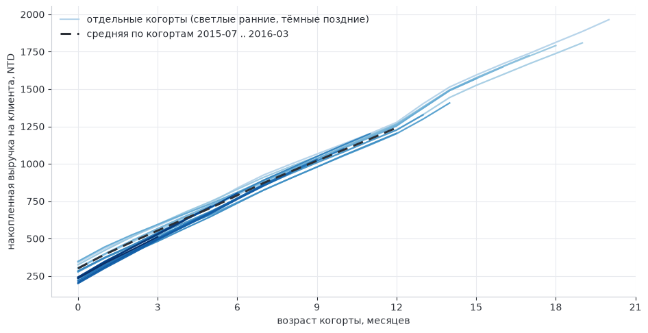
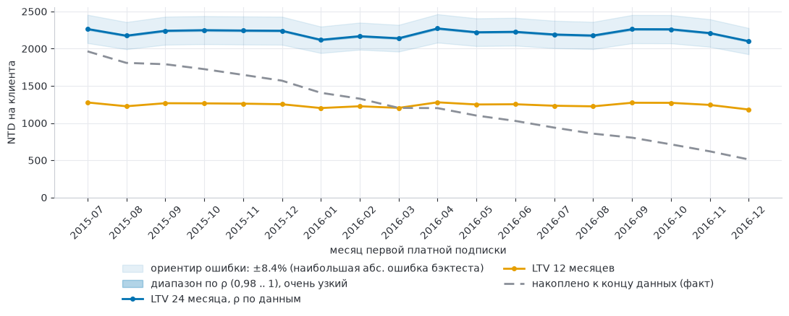
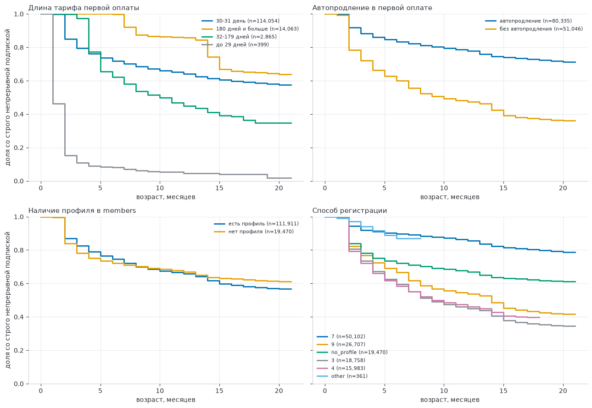
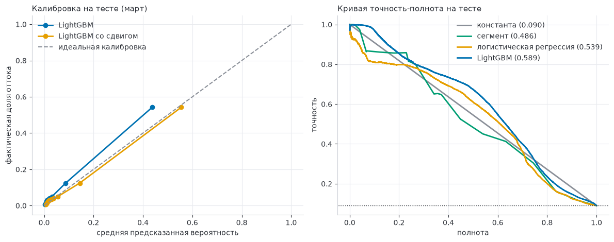
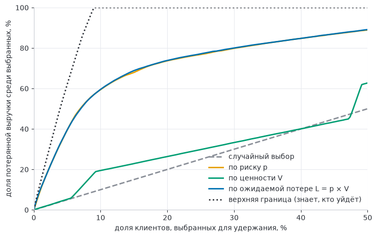
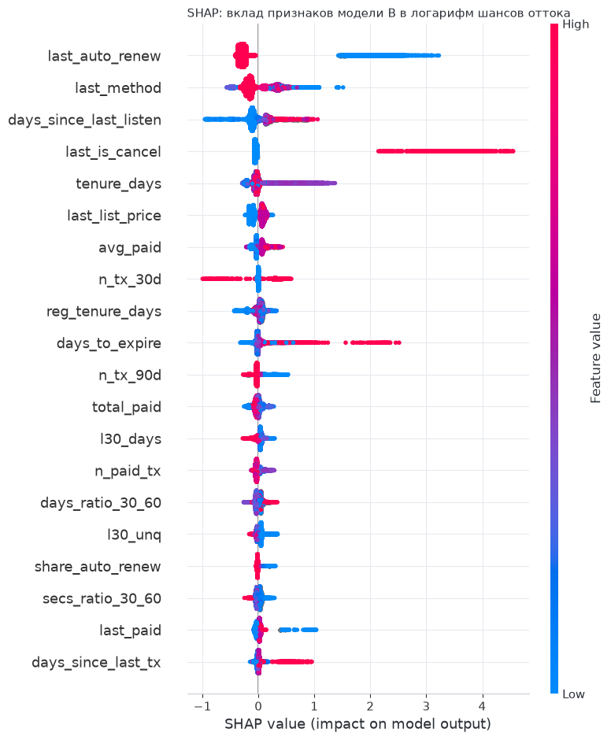

<h1 align="center">Subscription LTV & Retention</h1>

<p align="center">
  Анализ жизненного цикла подписчиков музыкального стримингового сервиса: LTV, отток и удержание.
</p>

<p align="center">
  
  
  
  
  
</p>

## О проекте

Проект на публичных данных подписочного сервиса KKBox (Kaggle): как ведут себя клиенты после оформления подписки, сколько денег они приносят и кого стоит удерживать.

**Решение, которое поддерживает проект.** В конце каждого месяца у сервиса заканчивается подписка примерно у миллиона клиентов. Часть из них можно привлечь к продлению удерживающим предложением (скидка, напоминание). Предложение стоит денег, поэтому нужно ответить на три вопроса:

1. *Сколько денег стоит клиент?* Это LTV: сколько выручки приносит когорта клиентов и сколько приносит один клиент за 12 и 24 месяца.
2. *Кто уйдёт?* Вероятность оттока на уровне клиента, оценённая по данным до начала месяца.
3. *Кому и в каком объёме предлагать?* Контактировать клиента стоит, если ожидаемая сохранённая выручка больше стоимости контакта:

   `e × p × V > c × m̄`

   где `p` вероятность оттока, `V` ценность клиента за горизонт (месячная цена × ожидаемое число активных месяцев), `e` доля уходящих клиентов, которых удаётся удержать, `c × m̄` стоимость контакта.

Путь проекта: разметка оттока и когорты → историческая и прогнозная LTV → выживаемость → модель оттока с проверкой на отложенном месяце → приоритизация удержания в деньгах → признаки из логов прослушивания и интерпретация модели.

## Ключевые результаты

| Тема | Результат |
|---|---|
| Удержание | К 12-му месяцу подписка непрерывна у 66% клиентов; у клиентов с автопродлением 78%, без него 47% |
| LTV | За 12 месяцев в среднем 1166 NTD на клиента, за 24 месяца 2101–2272 NTD по когортам; ошибка прогноза на отложенных месяцах 3–5% на горизонте 12 месяцев и 8,4% на 18 |
| Модель оттока | LightGBM на отложенном месяце: logloss 0,206 и PR-AUC 0,589 против 0,308 и 0,090 у константы |
| Приоритизация | 10% клиентов с наибольшим риском покрывают около 60% потерянной выручки, случайный выбор 10% |
| Ценность клиента | Различается слабо: учёт ценности почти не меняет отбор по сравнению с отбором по риску |
| Кампания удержания | При эффективности 10% и стоимости контакта 10% месячной цены выгодно контактировать около 19% клиентов; выгода порядка 5% потерянной выручки |
| Логи прослушивания | Дают небольшой прирост (PR-AUC +0,008); основной вклад у признаков транзакций и автопродления |

Суммы в тайваньских долларах (NTD).

## Данные

Соревнование Kaggle [WSDM – KKBox's Churn Prediction Challenge](https://www.kaggle.com/c/kkbox-churn-prediction-challenge): транзакции, логи прослушивания и профили пользователей за 2015–2017 годы.

| Таблица | Объём |
|---|---|
| Транзакции (основной файл и `_v2`) | 22,98 млн строк, 2,43 млн клиентов |
| Логи прослушивания | около 410 млн строк (392 млн до февраля 2017 и 18 млн за март) |
| Метки оттока | `train`: 992 931 клиент, отток 6,4% (подписка заканчивается в феврале 2017); `train_v2`: 970 960 клиентов, отток 9,0% (март 2017) |
| Профили | пол указан примерно у трети, возраст чаще всего записан нулём (пропуск) |

Данные не входят в репозиторий и распространяются на условиях правил соревнования: в репозитории нет строк данных и идентификаторов клиентов. Для воспроизведения их нужно скачать самостоятельно (раздел «Воспроизведение»).

Принципы работы с большим объёмом: DuckDB читает CSV и parquet с диска без загрузки в память; транзакции, профили и метки используются целиком, логи только для 10% клиентов (выборка по хешу `msno`, история клиента не разрывается).

## Методология и результаты

### 1. Разметка оттока и когорты

Отток определяется по логике соревнования: у клиента нет новой подписки в течение 30 дней после окончания текущей. Разметка переписана на SQL (`scripts/03_churn_labels.py`) и сверена с официальными метками: для февраля 2017 метка совпала у 98,4% общих клиентов. Для аналитики и LTV отток считается по транзакциям, для модели используются официальные метки.

Когорты и удержание: `scripts/04_active_months.py`, `notebooks/01_rare_segments.ipynb`, `notebooks/02_cohorts.ipynb`, теория в [docs/cohorts_and_retention.md](docs/cohorts_and_retention.md).

- Привязка когорты к регистрации даёт плоскую кривую удержания 14–17% (основная масса регистраций подписку не оформляет); привязка к первой платной подписке удерживает лучше первой подписки из-за пробных периодов (82,4% против 61,6% к 3-му месяцу).
- Через 12 месяцев строго удержано 64,2% когорты первой платной подписки, с учётом возвратов 74,4%: десятая часть клиентов уходила и возвращалась.
- Левое цензурирование заметно в когортах до июля 2015 года, поэтому когортный анализ начинается с июля 2015.
- Редкие категории (меньше 1000 клиентов) объединяются в «other».

### 2. LTV: история и прогноз

`notebooks/03_ltv_history.ipynb`, `notebooks/04_plans_discounts.ipynb`, `notebooks/05_ltv_forecast.ipynb`, теория в [docs/ltv.md](docs/ltv.md) и [docs/plans_and_discounts.md](docs/plans_and_discounts.md).

<p align="center">
  
</p>

- LTV за 12 месяцев в среднем 1166 NTD на клиента (по когортам 2015-07 .. 2016-03 от 1126 до 1202). Накопленная выручка растёт почти линейно: первая оплата в среднем 300 NTD, дальше около 72 NTD на клиента в месяц.
- Тариф 30 дней даёт 76% выручки, тариф 410 дней 8,5%. Скидки исчезли: 9,4% транзакций со скидкой в январе 2015 и около нуля с 2016 года, поэтому связь скидки с LTV оценить нельзя.
- Клиенты, начавшие с тарифа длиннее 31 дня (14% когорты), дают LTV за 12 месяцев 1701 NTD против 1168 NTD, но это в основном следствие предоплаты, а не доказательство лояльности.

Прогнозная LTV на 24 месяца: выручка на клиента в месяце жизни по всем когортам образует общий профиль, ненаблюдаемые возрасты продолжаются геометрическим хвостом, каждая когорта масштабируется на свой уровень. Метод проверен на отложенных месяцах: прогноз строится по платежам до отсечки и сравнивается с тем, что произошло после.

<p align="center">
  
</p>

- LTV за 24 месяца для когорт 2015-07 .. 2016-12 от 2101 до 2272 NTD на клиента, примерно в 1,7–1,8 раза больше LTV за 12 месяцев.
- Средняя абсолютная ошибка на отложенных месяцах 3–5% на горизонте 12 месяцев и 8,4% на 18 (прогноз занижает). Горизонт 24 месяца выходит за проверенный; ориентир неопределённости около ±8,4%.

### 3. Выживаемость

`notebooks/06_survival.ipynb`: оценка Каплана–Мейера и модель Кокса на выборке 15% клиентов когорт первой платной подписки 2015-07 .. 2016-12. Время жизни: число подряд идущих активных месяцев; клиенты, активные в марте 2017, цензурируются.

<p align="center">
  
</p>

- Доля клиентов со строго непрерывной подпиской: 82% к 3-му месяцу, 66,0% к 12-му (95% ДИ 65,7–66,3%), 58% к 18-му.
- Автопродление: S(12) 0,78 против 0,47 без него, отношение рисков в модели Кокса 0,31.
- Длина тарифа первой оплаты: 180 дней и больше 0,86, 30–31 день 0,64, 32–179 дней 0,45, до 29 дней 0,05. Часть эффекта длинных тарифов объясняется предоплатой.
- Конкордантность модели Кокса 0,741. Допущение пропорциональности рисков нарушено у длинных тарифов, тарифа до 29 дней и клиентов без профиля: для них отношение рисков описывает средний эффект за весь период.

### 4. Модель оттока

`scripts/05_churn_features.py`, `notebooks/07_churn_model.ipynb`. Эксперименты записываются в MLflow (эксперимент `churn_model`).

**Постановка.** Объект: клиент, у которого подписка заканчивается в месяце M. Момент прогноза: первый день месяца M. Признаки (32): состояние последней подписки, давность и стаж, история платежей, смены тарифа и способа оплаты, прежние перерывы, профиль. Обучение на феврале 2017, тест на марте 2017 (доля оттока выросла с 6,4% до 9,0%).

**Защита от утечки.** Признаки считаются только по транзакциям строго до даты прогноза; профиль берётся на ту же дату; преобразования (обрезка выбросов, объединение редких категорий) обучаются только на обучающем месяце; подбор параметров идёт по отложенной части февраля, март используется один раз.

| Модель | logloss | PR-AUC | ROC-AUC |
|---|---|---|---|
| Константа (доля оттока в обучении) | 0,308 | 0,090 | 0,500 |
| Доля оттока по сегменту (тариф, автопродление, дни до окончания) | 0,228 | 0,486 | 0,828 |
| Логистическая регрессия | 0,216 | 0,539 | 0,836 |
| **LightGBM** | **0,206** | **0,589** | **0,861** |

<p align="center">
  
</p>

- Модель занижает вероятности: среднее предсказание 6,4% при фактической доле оттока марта 9,0% (она унаследовала долю оттока обучающего месяца). Сдвиг логитов на долю марта снижает logloss с 0,206 до 0,198; основная часть потери качества на новом месяце связана с ранжированием.
- Важность признаков (доля gain): автопродление в последней транзакции 35,8%, признак отмены 15,8%, дни до окончания подписки 6,8%, доля транзакций с автопродлением 6,6%, число транзакций за 90 дней 6,2%.
- Вероятности занижены во всех группах; у клиентов без автопродления фактический отток 41,4% при среднем предсказании 32,5%.

### 5. Приоритизация удержания: риск × ценность

`notebooks/08_retention_value.ipynb`. Для клиентов марта 2017 (предсказания, не видевшие март при обучении) считаются ценность клиента `V` и ожидаемая потеря `L = p × V`.

- Ценность `V` = месячная цена (оплата последней транзакции, приведённая к 30 дням) × ожидаемое число активных месяцев за 12 месяцев для продливших клиентов (оценка по клиентам, продлившим подписку в марте 2016, по сегментам «группа тарифа × автопродление»).
- Фактически теряется около 9% клиентов; их ценность 129,6 млн NTD из 1385 млн суммарной ценности.

<p align="center">
  
</p>

| Правило отбора | Доля потерянной выручки среди 10% выбранных клиентов |
|---|---|
| Случайный выбор | 10% |
| По ценности `V` | 19,5% |
| По риску `p` | 59,4% |
| По ожидаемой потере `L = p × V` | 59,6% |

Ценность клиентов различается слабо (месячная цена у 90% клиентов от 99 до 180 NTD), а разброс вероятности оттока намного больше, поэтому отбор по `L` почти совпадает с отбором по риску. Отбор только по ценности выбирает дорогих клиентов с автопродлением, которые уходят редко.

**Экономика кампании.** Эффективность удержания `e` и стоимость контакта `c` (в долях месячной цены) заданы сценариями: причинный эффект удержания по этим данным оценить нельзя. Контактировать выгодно клиентов с `e × L > c × m̄` (горизонт 12 месяцев):

| e | c | Контактируем, % клиентов | Выгода по факту, млн NTD |
|---|---|---|---|
| 5% | 20% | 8 | 1,5 |
| 10% | 10% | 19 | 7,1 |
| 20% | 5% | 57 | 20,2 |

На горизонте 6 месяцев выгода примерно вдвое меньше. Потеря сосредоточена в узких группах: клиенты без автопродления составляют 12% и дают 55% фактической потери (отток 41,7% против 4,5% с автопродлением).

### 6. Логи прослушивания и интерпретация модели

`scripts/06_log_features.py`, `notebooks/09_logs_and_shap.ipynb`. Признаки из логов (три окна по 30 дней перед датой прогноза: дни прослушивания, число прослушиваний, время, уникальные песни, доли дослушанных и пропущенных песен, динамика активности, дней с последнего прослушивания). Логи месяца окончания подписки не используются. Логи есть только для выборки 10% клиентов (97 079 клиентов марта).

Модели A (без логов) и B (с логами) обучаются на одной подвыборке и сравниваются на марте; разность метрик оценена парным бутстрэпом по клиентам:

| Метрика | A | B | Разность B − A (95% интервал) |
|---|---|---|---|
| logloss | 0,2084 | 0,2070 | −0,0015 (от −0,0022 до −0,0007) |
| PR-AUC | 0,5877 | 0,5961 | +0,0084 (от +0,0045 до +0,0120) |
| ROC-AUC | 0,8661 | 0,8649 | −0,0011 (интервал включает ноль) |

Прирост небольшой; признаки из логов дают 15,2% суммарного gain. Модель, обученная на 79 тысячах клиентов, на тех же клиентах марта не хуже модели, обученной на всех: качество ограничено различием между месяцами, а не объёмом обучающих данных.

<p align="center">
  
</p>

SHAP описывает вклад признаков в предсказания модели: наибольший у автопродления (среднее значение +2,00 у клиентов без него, −0,29 с ним), затем способ оплаты, число дней с последнего прослушивания, признак отмены и стаж. Это описание модели, а не причинных связей.

## Выводы для бизнеса

- Удержание сосредоточено в узкой группе: клиенты без автопродления составляют 12% и дают более половины потерь. Перевод клиентов на автопродление и работа с этой группой дают наибольший эффект.
- Модель оттока позволяет заметно сузить круг контактов: 10% клиентов с наибольшим риском содержат около 60% потерянной выручки.
- Приоритет отбора определяется риском, а не ценностью клиента: ценность различается слабо.
- Порог кампании `e × p × V > c × m̄` показывает, при каких условиях предложение окупается. Эффективность удержания `e` в данных не наблюдается; её нужно измерять контролируемым экспериментом до масштабного запуска.

## Ограничения

- Данные наблюдательные: связи между признаками (автопродление, тариф, способ оплаты) и оттоком не являются причинными эффектами.
- «Активность» определяется по сроку действия подписки, а не по поведению клиента: у длинных тарифов предоплата удерживает клиента активным до конца оплаченного срока.
- Доля оттока в тестовом месяце выше, чем в обучающем; модель занижает вероятности, и денежные оценки используют справочный сдвиг к фактической доле оттока.
- Ценность клиента `V` оценена по сегментам, а не измерена: будущая выручка клиентов тестового месяца в данных отсутствует. Эффективность `e` и стоимость контакта `c` заданы сценариями.
- Логи прослушивания доступны для 10% клиентов; сравнение моделей с логами и без них выполнено на этой подвыборке.
- Расхождение числа клиентов собственной разметки и официальных меток (879 тыс. и 993 тыс. кандидатов в феврале) не объяснено; для модели используются официальные метки.

## Структура репозитория

```text
.
├── data/                 # данные и промежуточные файлы (в git не входят)
├── docs/                 # теория и план работ
│   ├── cohorts_and_retention.md
│   ├── ltv.md
│   ├── plans_and_discounts.md
│   ├── plan.md
│   └── img/              # графики для README
├── notebooks/
│   ├── 01_rare_segments.ipynb       # редкие сегменты
│   ├── 02_cohorts.ipynb             # когорты и удержание
│   ├── 03_ltv_history.ipynb         # историческая LTV
│   ├── 04_plans_discounts.ipynb     # тарифы и скидки
│   ├── 05_ltv_forecast.ipynb        # прогнозная LTV
│   ├── 06_survival.ipynb            # выживаемость
│   ├── 07_churn_model.ipynb         # модель оттока
│   ├── 08_retention_value.ipynb     # риск × ценность
│   └── 09_logs_and_shap.ipynb       # логи и SHAP
├── scripts/
│   ├── 01_profile_and_sample_choice.py
│   ├── 02_build_parquet.py
│   ├── 03_churn_labels.py
│   ├── 04_active_months.py
│   ├── 05_churn_features.py
│   └── 06_log_features.py
├── Dockerfile
├── docker-compose.yml
├── requirements.txt
└── setup.md
```

## Воспроизведение

**1. Данные.** Скачать файлы соревнования [KKBox Churn Prediction Challenge](https://www.kaggle.com/c/kkbox-churn-prediction-challenge) (`members_v3`, `train`, `train_v2`, `transactions`, `transactions_v2`, `user_logs`, `user_logs_v2`) и распаковать CSV в `data/interim/`; файлы с суффиксом `_v2` лежат в `data/interim/data/churn_comp_refresh/`.

**2. Окружение.** Контейнер для ноутбуков и сервер MLflow поднимаются через Docker Compose (альтернатива: Dev Containers в VS Code, подробности в [setup.md](setup.md)):

```bash
docker compose up -d --build
```

Интерфейс MLflow: `http://localhost:5001`.

**3. Скрипты** (по порядку; результаты сохраняются в `data/processed/`):

```bash
docker compose exec notebook python scripts/01_profile_and_sample_choice.py
docker compose exec notebook python scripts/02_build_parquet.py
docker compose exec notebook python scripts/03_churn_labels.py
docker compose exec notebook python scripts/04_active_months.py
docker compose exec notebook python scripts/05_churn_features.py
docker compose exec notebook python scripts/06_log_features.py
```

**4. Ноутбуки** (по номерам; `08_retention_value` использует предсказания, которые сохраняет `07_churn_model`, а `07` и `09` записывают запуски в MLflow):

```bash
docker compose exec notebook jupyter nbconvert --to notebook --execute --inplace notebooks/07_churn_model.ipynb
```

Тяжёлые операции (распаковка, чтение больших файлов) выполняются порциями или через DuckDB; ограничение памяти и число потоков заданы в начале скриптов и ноутбуков.

## Стек

Python 3.12, DuckDB, pandas, scikit-learn, LightGBM, lifelines, SHAP, MLflow, matplotlib, Docker, VS Code Dev Containers.

## Лицензия

См. файл [LICENSE](LICENSE).
